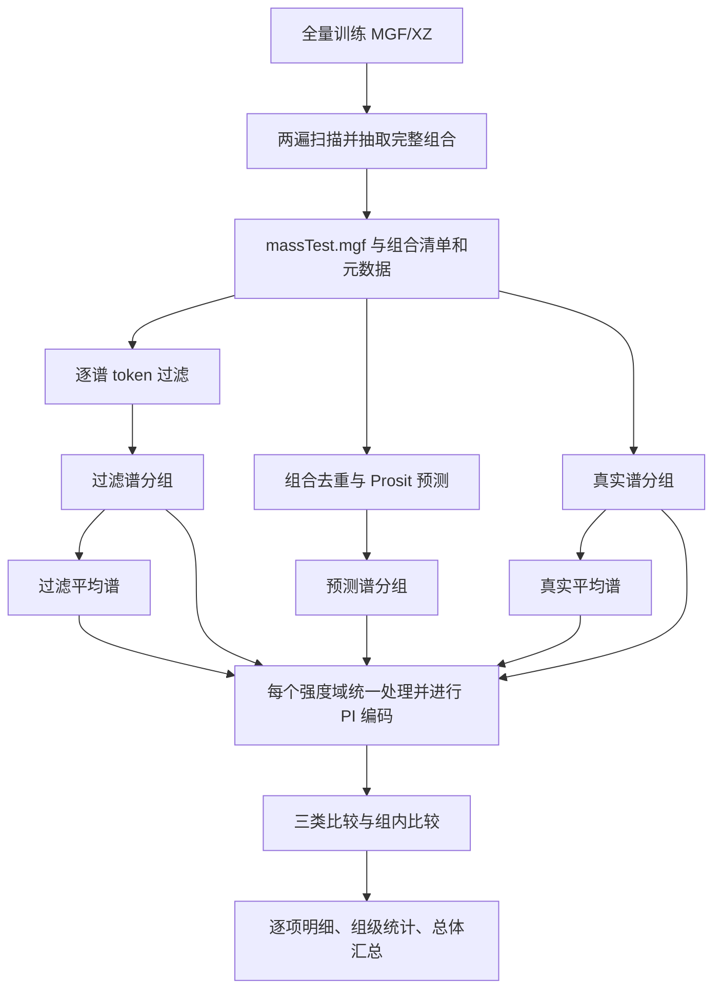

# massiveKB 30,000 组合实验：从抽样到相似度汇总的完整操作说明

本文面向实际运行实验、核对数据和整理结果的人员，按当前代码说明每一步的输入、处理、输出和执行方式。实际目录名称是 `v20_0918/transfomer/`，请保留这个拼写。

本文的已有样本统计和第 16 节结果属于 v2。新增的“30,000 个去修饰序列＋电荷唯一键，并逐组验证 Prosit 成功”的 v3 队列，生成规则及专用命令见 [v3 唯一 Prosit 输入子集说明](v3_唯一Prosit输入子集说明.md)。两个队列分别保存与分析。

## 1. 实验目标、数据单位和当前状态

任务一：从 massiveKB 的指定训练分区抽取 30,000 个唯一 peptide＋charge 组合，保留每个组合的全部真实谱；为每条真实谱生成过滤谱，为每个支持预测的组合生成一条 Prosit 谱。通过同一个 PI encoder 的嵌入余弦相似度，进行直接比较、平均谱比较和全交叉比较。

任务二：计算同一个 peptide＋charge 组合内部真实谱的两两相似度，衡量重复测量一致性；同时输出过滤谱的组内一致性。

术语约定：

- **组合/组**：去除首尾空白的原始 `SEQ` 字符串＋整数电荷。修饰及修饰写法属于键的一部分，不合并 I/L。
- **真实谱**：源数据的一条实验质谱。同组可以有多条真实谱。
- **过滤谱**：从一条真实谱中按 token 规则保留匹配峰的结果，与来源真实谱一一对应。
- **Prosit 谱**：一个组合的一条预测谱，不随该组真实谱数量重复生成。
- **相似度**：PI embedding 的余弦相似度，不是直接计算原始峰列表的余弦。
- **组内比较**：同一个组合的成员之间比较，不是不同 peptide 组之间比较。

本次已完成的本地样本：

| 项目 | 值 |
|---|---:|
| 源文件 | `massivekb_82c0124b_train.mgf.xz` |
| 源文件谱数 | 28,508,636 |
| 源文件组合数 | 2,029,550 |
| 至少 3 条谱的候选组数 | 1,083,521 |
| 入选组合数 | 30,000 |
| 子集真实谱数 | 741,558 |
| 每组最少/最多谱数 | 3 / 100 |
| 每组平均谱数 | 24.7186 |
| 双谱补齐组数(重复谱数量等于2的组去补齐30000，如果≥3个重复谱数量的唯一肽段+电荷不足30000的话) | 0 |
| 随机种子 | 20261010 |

截至 2026-10-12 收到的服务器完成日志，更新源码后的两个强度域均已完成 30,000 组比较，最终输出 `COMPLETE .../summary.csv`。Prosit 成功 28,914 组、跳过 1,086 组；真实和过滤侧各 30,000 组有效。正式结果、统计口径和输出位置见第 16 节。

## 2. 目录和脚本依赖

源码根目录在服务器为 `/home/wangyuhang/seq2mass`。

```text
Seq2Mass/
├── v20_0918/
│   ├── token_table.py
│   ├── dataset/
│   │   ├── TokenFilter_parallel.py
│   │   ├── TokenTableOriginalAnalyze_massivekb_mods_precise_tokens.py
│   │   └── AverageSpectrum_batch.py
│   └── transfomer/
│       ├── massivekb_pi_cosine/
│       │   ├── run_pipeline.py
│       │   ├── run_massivekb_pi_cosine.sh
│       │   ├── sample_massivekb_test.py
│       │   ├── mgf_io.py
│       │   ├── build_groups.py
│       │   ├── transform_mgf_intensity.py
│       │   ├── pairwise_cosine.py
│       │   ├── summary_all.py
│       │   └── tests/test_pipeline.py
│       ├── eval_10k_gt/
│       │   ├── prosit_predict_mgf.py
│       │   └── grouped_to_average_mgf.py
│       ├── ds/
│       │   ├── step4_prosit_score.py
│       │   └── ds_common.py
│       ├── predict_mgf.py
│       └── spectrum_transformer/       # 保留完整 Python 包
└── piprime_embedding/piprime_embedding/
    ├── mgf_to_embedding_batch.py
    ├── encoder_only.py
    ├── piprime_utils.py
    ├── PrimeNovo/                      # 保留配套源码与 config.yaml
    └── model.ckpt                      # PI 权重，可通过 --model 指定其他路径
```

`eval_10k_gt` 是历史目录名，不限制当前任务的组数。`predict_mgf.py` 等模块在这里提供解析和碎片计算功能，本任务不需要 V20 模型 checkpoint。

## 3. 整体流程和运行入口



正式分析统一使用 `run_pipeline.py`。它提供三个停止点：

| 参数 | 做到哪里 | 已传入 `--sample-dir` 时的行为 |
|---|---|---|
| `--stop-after sample` | 抽样阶段结束 | 校验现有子集，不重新抽样 |
| `--stop-after prepare` | 过滤、预测、分组、平均谱结束 | 校验子集后完成这些准备步骤 |
| `--stop-after full` | 编码、比较、汇总结束 | 校验/复用准备阶段后完成全流程 |

后续各步骤的单脚本命令用于解释接口和单独诊断。**正式运行采用第 13 节的统一入口命令,** 单脚本通常不负责主流程的阶段状态和内容校验。

## 4. 步骤一：从全量数据生成子集

### 4.1 输入与脚本

- 输入：完整的 `massivekb_82c0124b_train.mgf.xz`，也支持未压缩 MGF。
- 脚本：`massivekb_pi_cosine/sample_massivekb_test.py`。
- 公共工具：`massivekb_pi_cosine/mgf_io.py`。

### 4.2 处理逻辑

1. 第一遍完整读取源数据，统计每个 `(SEQ, charge)` 组合的谱数。
2. 候选键排序后，使用固定种子均匀抽样。优先从谱数 `N≥3` 的组中选 30,000 组。
3. 若优先池不足，则选完优先池，再从双谱组中随机补足；候选总数不足则报错。
4. 第二遍完整读取同一源文件，输出所有入选组合的全部真实谱。
5. 给每条输出谱增加 `SPECTRUM_ID=massivekb:<源文件中从 1 开始的谱块序号>`。
6. 校验源文件信息未变化、逐组提取数与第一遍统计数完全一致，再提交输出。

这是按组合均匀抽样，不是按谱数加权，也不是只取每组的 3 条谱。谱 ID 保留来源身份，后续不依赖 TITLE 唯一或文件行序。

### 4.3 本地 PowerShell 命令

下面命令用于**重新生成一个独立样本**，故使用新目录。已有正式子集无需重跑。

```powershell
$repo = 'E:/PythonProject/Seq2Mass'
$sourceMgf = 'E:/biodatasets/denovo/massivekb/massivekb_82c0124b_train.mgf.xz'
$sampleNew = 'E:/biodatasets/denovo/massivekb/massiveTest_v2_prefer3_new'

# 本机 Git 的 xz 支持多线程；这是本机路径，不适用于所有机器。
$env:PATH = 'E:/Git/mingw64/bin;' + $env:PATH
$env:XZ_DEFAULTS = '--memlimit-mt-decompress=2GiB'
$env:PYTHONIOENCODING = 'utf-8'

python -u "$repo/v20_0918/transfomer/massivekb_pi_cosine/sample_massivekb_test.py" `
  --mgf-xz "$sourceMgf" `
  --out-dir "$sampleNew" `
  --n-groups 30000 --prefer-spectra 3 --min-spectra 2 `
  --seed 20261010 --threads 8 --progress-every 1000000
```

脚本拒绝覆盖已完成的样本。正式抽样不要加 `--max-spectra`，它只读取源文件前缀，会产生有偏调试样本。当前 `--limit-groups` 属于主入口的抽样规模参数，不能用它自动从已上传的 30,000 组子集中裁出小样；与现有 `--sample-dir` 搭配时会按目标组数校验并可能报错。

### 4.4 输出

| 文件 | 数据内容 |
|---|---|
| `massTest.mgf` | 入选组合全部真实谱，原始峰与注释保留，增加稳定谱 ID |
| `massTest_groups.tsv` | 每个组合一行：`group_id, group_file, sequence, charge, n_spectra, emitted, sampling_stratum` |
| `massTest_meta.json` | schema、参数、源文件信息、候选池、优先/补齐数量、组大小分布、总谱数和耗时 |

`massTest.mgf` 是脚本沿用的文件名，对应本实验所称 massiveTest。`--dump-all-groups` 可额外导出全源组合计数，不是默认产物。

`--min-spectra 2` 表示允许不足时双谱补齐；本次实际没有补齐组。复用本次样本时继续传 `2`，因为主流程核对抽样元数据，不能事后改成 `3`。

## 5. 步骤二：校验、打包与上传

### 5.1 校验内容

子集必须包含恰好 30,000 个组合；MGF 逐组计数应与 TSV 一致，谱 ID 不缺失、不重复，总谱数与 JSON 一致，优先抽样策略符合元数据。

在服务器使用第 13 节的 `--stop-after sample` 可以执行主流程校验。校验 `SHA256SUMS.txt` 则用于确认传输后的内容与打包时一致，两种检查用途不同。

本次交付包中的 `validation_report.json`、`README_server.md`、`SHA256SUMS.txt`、ZIP 和 ZIP 校验值由交付时额外的校验/打包流程生成，**不是 `sample_massivekb_test.py` 自动生成的文件**。

### 5.2 为新抽样目录打包的可选命令

如果未来重新抽样，可在本地 PowerShell 用以下方式为三件套生成 LF 换行校验清单并打包。先确保抽样成功，且目标 ZIP 尚不存在。

```powershell
@'
import hashlib
from pathlib import Path
import zipfile

folder = Path('E:/biodatasets/denovo/massivekb/massiveTest_v2_prefer3_new')
files = ['massTest.mgf', 'massTest_groups.tsv', 'massTest_meta.json']
def sha(p):
    h = hashlib.sha256()
    with p.open('rb') as f:
        for block in iter(lambda: f.read(8 * 1024 * 1024), b''):
            h.update(block)
    return h.hexdigest()

checks = ''.join(f'{sha(folder / name)}  {name}\n' for name in files)
(folder / 'SHA256SUMS.txt').write_bytes(checks.encode('ascii'))
archive = folder.with_suffix('.zip')
with zipfile.ZipFile(archive, 'x', compression=zipfile.ZIP_DEFLATED,
                     compresslevel=1, allowZip64=True) as z:
    for name in files + ['SHA256SUMS.txt']:
        z.write(folder / name, arcname=folder.name + '/' + name)
with zipfile.ZipFile(archive) as z:
    assert z.testzip() is None
Path(str(archive) + '.sha256').write_bytes(
    f'{sha(archive)}  {archive.name}\n'.encode('ascii'))
print(archive)
'@ | python -
```

### 5.3 本次已生成 ZIP 的服务器解压

本次原包大小为 `1693025814` 字节，SHA-256 为：

```text
c6bd86dd28eaf3329d3bde9e5f962c144e72f00fda5bfa315d123a97ab32805d
```

这个值只对应本次原包，不适用于未来重新压缩的包。

```bash
cd /data/wangyuhang2/datasets/massivekb
stat -c '%s bytes' massiveTest_v2_prefer3.zip
sha256sum massiveTest_v2_prefer3.zip
unzip -t massiveTest_v2_prefer3.zip
unzip massiveTest_v2_prefer3.zip -d /data/wangyuhang2/datasets/kb30000

cd /data/wangyuhang2/datasets/kb30000/massiveTest_v2_prefer3
# 本次原包清单为 Windows 换行，先只修正校验清单。
sed -i 's/\r$//' SHA256SUMS.txt
sha256sum -c SHA256SUMS.txt
```

如果已经解压并校验成功，跳过这一节。不要批量修改 MGF、TSV、JSON、README 的换行，否则会改变其校验值。服务器后续不需要原始 46.7 GB XZ 文件；元数据中的 Windows 源路径用于记录来源，无须在服务器存在。

## 6. 步骤三：生成一一对应的过滤谱

**输入**：`massTest.mgf`。

**脚本**：`v20_0918/dataset/TokenFilter_parallel.py`，调用 `TokenTableOriginalAnalyze_massivekb_mods_precise_tokens.py` 和 `v20_0918/token_table.py`。

**处理**：解析带修饰序列和电荷，按 b/y 碎片及 token 偏移构建匹配条件，保留容差范围内的实验峰。默认容差 `0.05 Da`；碎片电荷范围为 `1..min(3, precursor_charge)`。只选择峰，不额外改变峰强度。并行输出保持顺序，原谱 ID 保留。

**输出**：`massTest_filtered.mgf`。本次应有 741,558 条谱，组合和谱 ID 集合与真实谱相同。`kept=741558` 表示谱块都保留，不表示所有峰都保留。无可用峰的过滤谱保留身份，由后续编码标记无效。

接口示例，`FILTER_DIR` 是手工诊断时自行设置的输出目录：

```bash
mkdir -p "$FILTER_DIR"
python "$REPO/v20_0918/dataset/TokenFilter_parallel.py" \
  "$SAMPLE/massTest.mgf" "$FILTER_DIR/massTest_filtered.mgf" \
  --tol 0.05 --workers 8
```

统一入口另外核对真实/过滤的逐组计数以及谱 ID 到组合的映射，发现丢谱或身份改变就停止。

## 7. 步骤四：生成 Prosit 预测谱(len <= 30aa) - 删修饰 -预测骨架- 加回修饰偏移

**输入**：主流程从子集组合清单生成的 `massTest_seqs.npz`，包含等长的 `seqs` 和 `charges` 数组，每个原始组合一条。

**脚本**：`eval_10k_gt/prosit_predict_mgf.py`；预测和缓存由 `ds/step4_prosit_score.py` 的组件处理，另依赖 `ds_common.py`、`predict_mgf.py` 及其导入模块。

**处理**：

1. 将带修饰序列解析为未修饰骨架，对 `(backbone, charge)` 去重，并读取匹配缓存。
2. 向 Koina 请求 `Prosit_2025_intensity_MultiFrag`，使用 HCD 碎裂类型。
3. 当前方法用骨架预测强度，再按 b/y 注释将峰重锚到带修饰的理论 m/z，并合并近邻峰。它没有直接建模修饰对峰强度的影响。
4. 峰排序时同步排列 m/z、强度和注释；仅保留符合导出规则的可用预测峰。
5. 每个成功的原始 `(SEQ, charge)` 输出一条谱；跳过项写明原因，成功和跳过集合合起来应覆盖全部 30,000 组。

本次日志中的 28,633 是待请求的唯一骨架＋电荷数；28,914 是最终成功输出的原始组合数，二者统计单位不同。不同修饰组合可能共享骨架请求，不能把这两个数直接相减作为失败数量。

**输出**：

| 文件 | 内容 |
|---|---|
| `massTest_seqs.npz` | 本阶段请求所用的原始组合清单 |
| `prosit_predicted.mgf` | 每个成功组合的一条模拟谱 |
| `prosit_skipped.csv` | `sequence, charge, reason, detail`，记录不支持、请求失败或空输出等情况 |
| 缓存文件 | 指定缓存名追加 `.aligned-v2` 的缓存及分段文件，位于分析根目录等指定位置 |

当前代码限制骨架长度不超过 30；不要把全部跳过项都推断为超长，具体查看原因列。本次服务器日志为成功 28,914、跳过 1,086，成功率 96.38%；这不是最终共同有效编码组数。

接口示例：

```bash
python "$REPO/v20_0918/transfomer/eval_10k_gt/prosit_predict_mgf.py" \
  --npz "$PROSIT_DIR/massTest_seqs.npz" \
  --out "$PROSIT_DIR/prosit_predicted.mgf" \
  --cache "$OUT/koina_cache.tsv.gz" \
  --skipped-out "$PROSIT_DIR/prosit_skipped.csv"
```

这里的 NPZ 由主入口自动创建，不能只新建空目录后直接运行。可以用主入口的 `--prosit-mgf` 导入外部预测；`--skip-prosit` 则仅运行过滤侧和任务二，不满足完整两方法比较的目标。

## 8. 步骤五：分别按组合分组

**脚本**：`massivekb_pi_cosine/build_groups.py`。

**输入和输出**：

| 输入 MGF | 阶段名 | 每个组合文件的内容 |
|---|---|---|
| `massTest.mgf` | `grouped_real` | 该组 N 条真实谱 |
| `massTest_filtered.mgf` | `grouped_filtered` | 同组 N 条过滤谱 |
| `prosit_predicted.mgf` | `grouped_prosit` | 成功组的一条预测谱 |

每个输出目录有多个组合 MGF 和 `group_map.csv`，用于映射组合键、文件名、真实/预测谱计数。真实与过滤组集必须相同，预测组集可以是其子集。

接口示例：

```bash
python "$TASK/build_groups.py" \
  --original-mgf "$SAMPLE/massTest.mgf" --out-dir "$GROUP_REAL"
python "$TASK/build_groups.py" \
  --original-mgf "$FILTER_DIR/massTest_filtered.mgf" --out-dir "$GROUP_FILTERED"
python "$TASK/build_groups.py" \
  --prediction-mgf "$PROSIT_DIR/prosit_predicted.mgf" --out-dir "$GROUP_PROSIT"
```

过滤谱这里走 `--original-mgf` 分支，内部也可能标记 `SOURCE=ORIGINAL`；这不代表误用了真实谱。真实/过滤的实验角色由输入文件和阶段目录区分，身份由 `SPECTRUM_ID` 核对。预测组日志显示 `0 groups with originals` 也属于正常现象，要看 prediction 谱数。

## 9. 步骤六：计算真实平均谱和过滤平均谱

**脚本**：`eval_10k_gt/grouped_to_average_mgf.py`，算法来自 `dataset/AverageSpectrum_batch.py`。

**输入**：`grouped_real` 或 `grouped_filtered` 中同一组的 N 条谱。

**处理**：在原始强度域，把峰按 m/z 排序；以当前簇的最小 m/z 为 anchor，合并 `[anchor, anchor+0.05]` 范围内的峰。同一谱在一个簇内有多峰时取最大强度；对 N 条谱求和再除以 N，缺峰按 0 计。输出峰的 m/z 使用 anchor。

**输出**：`avg_real` 和 `avg_filtered`，每个组合一个 MGF，每个文件一条平均谱，本次各 30,000 条。不是先编码再平均 embedding。

```bash
python "$REPO/v20_0918/transfomer/eval_10k_gt/grouped_to_average_mgf.py" \
  --mgf-dir "$GROUP_REAL" --out-dir "$AVG_REAL" --tol 0.05
python "$REPO/v20_0918/transfomer/eval_10k_gt/grouped_to_average_mgf.py" \
  --mgf-dir "$GROUP_FILTERED" --out-dir "$AVG_FILTERED" --tol 0.05
```

## 10. 步骤七：统一强度域并生成 PI embedding

### 10.1 强度变换

**脚本**：`massivekb_pi_cosine/transform_mgf_intensity.py`。

**输入**：五套分组谱 `real / filtered / prosit / avg_real / avg_filtered`。

**处理和输出**：

| domain | 处理 | 输出 |
|---|---|---|
| `none` | 不做额外外部强度变换 | 主入口直接使用原分组目录 |
| `sqrt_clip` | `sqrt(min(x,50000)/50000)` | 对应变换后的 MGF 目录 |
| `sqrt`（可选） | `sqrt(x)` | 对应变换后的 MGF 目录 |

```bash
python "$TASK/transform_mgf_intensity.py" \
  --in "$GROUP_REAL" --out "$REAL_SQRT_CLIP" --transform sqrt_clip
```

主入口会对该域的五套谱都应用同一种变换，不能只对真实谱变换。平均谱必须先在原始强度域计算，再变换。`none` 仅表示没有这一层额外变换，**PI encoder 内部的预处理仍然执行**。

### 10.2 PI 编码

**入口**：`piprime_embedding/piprime_embedding/mgf_to_embedding_batch.py`。

**依赖**：`encoder_only.py`、`piprime_utils.py`、`PrimeNovo/` 源码和配置，以及 `--model` 指定的 PI checkpoint。

**输入**：某个强度域中的一套分组 MGF 目录。

**处理**：读取每条谱并按 PI 配置裁剪 m/z、去除前体邻域、筛选强度与峰数，执行 root 强度缩放和 L2 归一化；严格加载 checkpoint 的 encoder 权重，计算 `encoder(peaks).mean(dim=1)`。当前配置为 m/z 1–6500、前体邻域 1 Da、最多 800 峰，已验证 checkpoint 的嵌入维度为 400；实际参数以配置和产物 provenance 为准。

主入口启用 `--strict-preprocessing`，依赖 `spectrum_utils`。无可用峰的谱写入 NaN embedding 和原因，不用虚拟峰替代。其他异常会使阶段失败。GPU 由 `--gpu` 控制；程序在 CUDA 不可用时可能使用 CPU，运行前应主动检查。

**输出**：每个组合一个 `.npz`，与输入 MGF 同名；另有 `embedding_provenance.json`。

| NPZ 字段 | 含义 |
|---|---|
| `embeddings` | N×D 嵌入矩阵；预测谱/平均谱通常 N=1 |
| `spectrum_ids` | 与每行嵌入对应的谱身份 |
| `invalid_reasons` | 无效原因，正常项为空 |
| `titles` | 原谱标题 |
| `precursor_mz`、`charges` | 前体信息 |
| `sources` | 谱来源标签 |

```bash
CUDA_VISIBLE_DEVICES=0 python "$REPO/piprime_embedding/piprime_embedding/mgf_to_embedding_batch.py" \
  --mgf_dir "$GROUP_REAL" \
  --output_dir "$EMB_REAL" \
  --model "$MODEL" \
  --strict-preprocessing
```

主入口在每个域处理五套输入，默认两个域共十套编码阶段。若没有成功 Prosit 组，会省略预测侧编码；真实组内任务仍可运行。

## 11. 步骤八：计算三类相似度和任务二

**脚本**：`massivekb_pi_cosine/pairwise_cosine.py`。

**输入**：同一强度域中的五套 MGF 及对应 NPZ。真实、过滤和预测分组目录还提供 `group_map.csv`。

先核对组键、谱数和谱 ID；NPZ 行顺序与 MGF 不一致时按 ID 重排。余弦计算前对 embedding 做 L2 归一化，不直接比较不同域的向量。

记同组真实谱为 `r_i`、对应过滤谱为 `f_i`、预测谱为 `q`；`R`、`F` 分别为真实和过滤平均谱；`cos` 表示对应 PI 嵌入的余弦。

| mode | filtered 组级结果 | Prosit 组级结果 |
|---|---|---|
| `direct` | `mean_i cos(f_i,r_i)` | `mean_i cos(q,r_i)` |
| `averaged_each` | `mean_i cos(f_i,R)` | `cos(q,R)` |
| `averaged` | `cos(F,R)` | `cos(q,R)` |
| `pairwise` | `mean_j mean_i cos(f_j,r_i)`，共 N² 项 | `mean_i cos(q,r_i)` |

对 `(A,B,C)` 和 `(A',B',C')`，filtered pairwise 先分别求 `A'` 对 `A/B/C` 的均值、`B'` 对 `A/B/C` 的均值、`C'` 对 `A/B/C` 的均值，再平均，等价于 9 项均值。它包含 3 个一一对应项；额外输出的 `filtered_offdiag` 排除这些对应项。

Prosit 的 direct 和 pairwise 按定义相同；两种 averaged 模式在 Prosit 侧也相同，不作为独立证据重复解释。

任务二的 `real_real` 为真实谱 `i<j` 的余弦均值，共 `N(N−1)/2` 项；N=3 时为 A–B、A–C、B–C。另报告 `filtered_filtered` 和真实谱对真实平均谱的 `orig_vs_avg`。真实组内一致性是参考基准，不是预测相似度的数学上限。

单独调用接口示例：

```bash
python "$TASK/pairwise_cosine.py" \
  --ref-grouped-dir "$GROUP_REAL" --ref-emb-dir "$EMB_REAL" \
  --src-grouped-dir "$GROUP_FILTERED" --src-emb-dir "$EMB_FILTERED" \
  --avg-ref-grouped-dir "$AVG_REAL" --avg-ref-emb-dir "$EMB_AVG_REAL" \
  --avg-src-grouped-dir "$AVG_FILTERED" --avg-src-emb-dir "$EMB_AVG_FILTERED" \
  --prosit-grouped-dir "$GROUP_PROSIT" --prosit-emb-dir "$EMB_PROSIT" \
  --domain none --out-dir "$METRICS_NONE"
```

所有路径必须来自同一域。指标输出目录必须是新的，已有指标文件时脚本会拒绝覆盖。明细始终保存，不需要额外传 `--save-detail`。

### 11.1 输出文件与预期规模

以下行数均不含表头，指完整 30,000 组样本的每个强度域；无效值保留行，不通过删行改变样本规模。

| 文件 | 内容 | 预期行数 |
|---|---|---:|
| `mode1_direct.csv` | 每条真实谱的两源 direct 和状态 | 741,558 |
| `mode2_averaged.csv` | 每组平均谱相关比较 | 30,000 |
| `mode2_filtered_detail.csv` | 每条过滤谱/真实谱对真实平均谱的相似度 | 741,558 |
| `mode3_pairwise.csv` | 每组两源全交叉均值、过滤非对应项均值 | 30,000 |
| `mode3_filtered_means.csv` | 每条过滤谱对整组真实谱的均值 | 741,558 |
| `mode3_pairs.csv.gz` | 过滤×真实全部谱对、两个谱 ID 和相似度 | `sum(N_g²)` |
| `task2_within_group.csv` | 每组真实/过滤组内 mean/min/max 和谱对数 | 30,000 |
| `task2_pairs.csv.gz` | 全部 i<j 的两个 ID 及真实/过滤相似度 | `sum(N_g(N_g−1)/2)` |
| `group_metrics.csv` | 每组每源每指标的有效性及统计量 | 330,000（每组 11 行） |

这些表包含组合、序列、电荷和域信息。Prosit pairwise 的逐谱值已经包含在 direct 明细中，不重复生成一份相同的大表。

### 11.2 无效结果的规则

缺文件、组键错配、ID 重复或缺失、谱数不匹配会直接报错。无峰、非有限/零向量、缺预测等数据无效情况则保留 NaN 和相应记录。

`group_metrics.csv` 中 `n_values` 是理论比较项数，`n_valid_values` 是有限有效项数，`valid` 表示该组该指标的全部预期项是否有效。只有所有预期项有效，才使用该组指标参与汇总，不把剩余有效项单独平均后冒充完整组。

## 12. 步骤九：总体汇总与报告整理

**脚本**：`massivekb_pi_cosine/summary_all.py`。

**输入**：两个域各自的 `group_metrics.csv`。

```bash
python "$TASK/summary_all.py" \
  --metrics "$METRICS_NONE/group_metrics.csv" "$METRICS_SQRT_CLIP/group_metrics.csv" \
  --out-dir "$SUMMARY_DIR"
```

**处理**：按域、来源、指标、样本层和权重口径汇总，拒绝重复的组级记录。

| 字段/取值 | 含义 |
|---|---|
| `domain` | `none` 或 `sqrt_clip`，分开解释 |
| `source` | `filtered`、`prosit`、`baseline` |
| `mode` | direct、averaged_each、averaged、pairwise 或基准指标 |
| `layer=all` | 该来源/指标的全部组及有效性统计 |
| `layer=paired` | 同域、同指标、两方法都有效的组交集 |
| `N2 / N3-5 / N6-10 / N>10` | 按真实谱数量分桶；本次 N2 为空 |
| `paired_*` | 共同有效组内部的对应分桶 |
| `weighting=group` | 每个有效组等权 |
| `weighting=pooled` | 每个实际比较项等权 |
| `n_groups_expected / n_groups / n_groups_invalid` | 所选层的预期、有效、无效组数 |
| `n_units` | group 时为有效组数；pooled 时为总比较项数 |
| `mean / std` | 所选权重下均值和标准差 |
| `p10 / median / p90` | 仅 group 行报告组均值的分位数 |

pooled 权重：direct 为 N；filtered pairwise 为 N²，Prosit pairwise 为 N；组内 `real_real` 和 `filtered_filtered` 为 N(N−1)/2，`orig_vs_avg` 为 N；平均谱对平均谱为 1；filtered averaged_each 为 N，Prosit averaged_each 为 1。不同方法的 pooled 分母可能不同，即使 paired 组集合相同。

**输出**：

- `summary.csv`：所有上述汇总。
- `task2_summary.csv`：`source=baseline` 的汇总，包含 `real_real`、`filtered_filtered` 和 `orig_vs_avg`，不只包含真实谱两两比较。

报告建议以 `domain=none, layer=paired, weighting=group` 作为两方法比较主表；以 `sqrt_clip` 的同口径结果作对照。任务二主表筛选 `source=baseline, mode=real_real, layer=all, weighting=group`。同时报告 Prosit 跳过原因和 all 层无效组数；paired 层已经剔除了两侧任一无效的组，不能单看它判断总失败率。

保留两域的组级表、全部压缩明细、清单、配置和日志。大型谱对 CSV.GZ 适合程序读取，不必全部导入 Excel。

## 13. 服务器实际操作：推荐执行这一节

这组命令使用本次服务器实际路径。先激活已配置的 `s2m` 环境，在同一个 Bash 会话中依次执行。已有子集不再重新抽样。

### 13.1 路径和环境检查

```bash
conda activate s2m

REPO=/home/wangyuhang/seq2mass
TASK="$REPO/v20_0918/transfomer/massivekb_pi_cosine"
PIPE="$TASK/run_pipeline.py"
SAMPLE=/data/wangyuhang2/datasets/kb30000/massiveTest_v2_prefer3
OUT=/data/massiveTest_v2KB30000_analysis
MODEL="$REPO/piprime_embedding/piprime_embedding/model.ckpt"
GPU=0

mkdir -p "$OUT"
test -f "$PIPE" && test -f "$MODEL" && test -f "$SAMPLE/massTest.mgf"

python "$REPO/piprime_embedding/piprime_embedding/mgf_to_embedding_batch.py" --help
```

帮助中必须出现 `--strict-preprocessing`。主要 Python 依赖包括 numpy、pandas、torch、pyteomics、spectrum_utils、koinapy、PyYAML、einops，以及共享代码的间接依赖；这是环境检查说明，不是经过锁版本验证的完整安装清单。优先使用服务器已配置的环境。

```bash
CUDA_VISIBLE_DEVICES="$GPU" \
PYTHONPATH="$REPO/piprime_embedding/piprime_embedding${PYTHONPATH:+:$PYTHONPATH}" \
python - "$MODEL" <<'PY'
import sys
import numpy, pandas, torch, pyteomics.mgf, spectrum_utils.spectrum, koinapy
from encoder_only import load_model
model, config, device = load_model(sys.argv[1])
print('模型已加载；device =', device, 'embedding dimension =', config['dim_model'])
assert device.type == 'cuda', '正式全量编码前请确认 GPU/PyTorch 环境'
PY
```

依赖导入成功不等于 Koina 网络可达，在线预测阶段还会实际请求服务。

### 13.2 固定实验参数

```bash
COMMON=(
  --sample-dir "$SAMPLE"
  --out-dir "$OUT"
  --model "$MODEL"
  --n-groups 30000
  --prefer-spectra 3
  --min-spectra 2
  --seed 20261010
  --domains none,sqrt_clip
  --tol-filter 0.05
  --tol-average 0.05
  --workers 8
  --gpu "$GPU"
)
set -o pipefail
```

`pipefail` 使 Python 失败不会被 `tee` 的成功退出码掩盖。任一步报错时，先解决该错误再执行下一步。每次开启新终端，都需重新设置这些变量和 COMMON 数组。

### 13.3 校验已上传样本

```bash
python -u "$PIPE" "${COMMON[@]}" --stop-after sample \
  2>&1 | tee "$OUT/01_validate_$(date +%Y%m%d_%H%M%S).log"
```

成功后状态为 `sample_complete`，输入样本不被重新生成。

### 13.4 完成准备阶段

```bash
python -u "$PIPE" "${COMMON[@]}" --stop-after prepare \
  2>&1 | tee "$OUT/02_prepare_$(date +%Y%m%d_%H%M%S).log"
```

依次执行过滤、Prosit、三套分组、两套平均谱，成功后状态为 `prepare_complete`。

### 13.5 完成编码、比较和汇总

```bash
python -u "$PIPE" "${COMMON[@]}" --stop-after full \
  2>&1 | tee "$OUT/03_full_$(date +%Y%m%d_%H%M%S).log"
```

也可以在环境和数据校验无误后直接执行这一条，主入口会自动补齐全部前序阶段。保持会话持续运行，或使用服务器已有的终端会话/作业调度方式执行。

### 13.6 检查完成状态并定位结果

```bash
python - "$OUT" <<'PY'
import json
import sys
from pathlib import Path
root = Path(sys.argv[1])
m = json.loads((root / 'run_manifest.json').read_text())
print('status:', m['status'])
for name, path in m['paths'].items():
    print(name, '=>', path)
assert m['status'] == 'complete', '尚未全部完成，请查看日志'
summary = Path(m['paths']['summary'])
print('总体汇总:', summary / 'summary.csv')
print('基准汇总:', summary / 'task2_summary.csv')
PY
```

### 13.7 检查 Prosit 跳过原因与生成报告主表

完成后可执行以下命令，把报告常用表复制/筛选到 `report_tables/`，原始阶段产物不修改：

```bash
python - "$OUT" <<'PY'
import json
import sys
from pathlib import Path
import pandas as pd

root = Path(sys.argv[1])
m = json.loads((root / 'run_manifest.json').read_text())
assert m['status'] == 'complete'
paths = {k: Path(v) for k, v in m['paths'].items()}
report = root / 'report_tables'
report.mkdir(exist_ok=True)
s = pd.read_csv(paths['summary'] / 'summary.csv')
for domain in ('none', 'sqrt_clip'):
    main = s[(s.domain == domain) & (s.layer == 'paired') &
             (s.weighting == 'group') & s.source.isin(['filtered', 'prosit'])]
    main.to_csv(report / f'comparison_{domain}.csv', index=False)
    coverage = s[(s.domain == domain) & (s.layer == 'all') &
                 (s.weighting == 'group') & s.source.isin(['filtered', 'prosit'])]
    coverage.to_csv(report / f'coverage_all_{domain}.csv', index=False)
    baseline = s[(s.domain == domain) & (s.layer == 'all') &
                 (s.weighting == 'group') & (s.source == 'baseline') &
                 (s['mode'] == 'real_real')]
    baseline.to_csv(report / f'task2_real_real_{domain}.csv', index=False)
if 'prosit' in paths:
    skipped = pd.read_csv(paths['prosit'] / 'prosit_skipped.csv')
    counts = skipped.groupby('reason').size().rename('n_groups').reset_index()
    counts.to_csv(report / 'prosit_skip_reasons.csv', index=False)
    print(counts.to_string(index=False))
print('报告表目录:', report)
PY
```

这些 `report_tables` 文件是上述辅助命令生成的，不是主流程自动输出。两种 averaged 口径应分别注明，不能合成一个未定义的平均指标。

## 14. 输出目录、续跑和常见问题

### 14.1 目录结构

```text
/data/massiveTest_v2KB30000_analysis/
├── run_manifest.json
├── state/
├── logs/pipeline.log
├── koina_cache.tsv.gz.aligned-v2...     # 实际缓存及分段文件
├── filtered-<指纹>-<标识>/
├── prosit-<指纹>-<标识>/
├── grouped_real-.../
├── grouped_filtered-.../
├── grouped_prosit-.../
├── avg_real-.../
├── avg_filtered-.../
├── 各套谱的 sqrt_clip 变换目录/
├── emb_<谱类型>_<域>-.../
├── metrics_none-.../
├── metrics_sqrt_clip-.../
└── summary-.../
```

目录后缀不是固定值，从 `run_manifest.json` 的 `paths` 读取，不要猜目录名。每个成功阶段有 `stage_manifest.json`，记录参数、依赖、代码与文件内容指纹。

### 14.2 续跑的实际粒度

主流程先在 `.partial-*` 目录构建阶段，完成并校验后提交正式目录和状态。重跑时只有参数、输入、代码、相关包版本和输出内容检查都匹配，才复用阶段。

复用是**阶段级**，不是所有单脚本都能从中断行继续。中断的编码阶段可能重新编码整套输入；Prosit 则另有请求缓存机制。代码指纹覆盖范围较广，只改编码源码也可能触发前序阶段重建。

修复后使用同一 `--out-dir` 重跑 `--stop-after full`。不要随意删除缓存、伪造状态清单或加 `--force`；`--force` 会在新目录重建阶段。代码更新和重新生成的阶段会增加磁盘占用。两个域和完整谱对明细的空间需求不能只按 3.4 GB 输入 MGF 估计。

### 14.3 常见现象及处理

| 现象 | 解释和处理 |
|---|---|
| ZIP 找不到 central directory | 核对大小与 SHA256，检查上传是否完整；不要继续使用损坏包 |
| 校验提示文件名末尾 `$'\r'` | 只对 `SHA256SUMS.txt` 执行 `sed -i 's/\r$//'` |
| 不识别 `--strict-preprocessing` | 编码脚本旧版；同步配套代码，不删除参数绕过 |
| 预测输出少于 30,000 组 | 查看跳过 CSV；保持原样本，报告覆盖率和共同有效组 |
| 预测目录显示 0 original groups | 预测侧没有真实谱，查看 prediction blocks 数量 |
| 过滤 kept 等于输入谱数 | 代表谱块保留，不代表未过滤峰 |
| none 域仍做 root 缩放 | none 只关闭外部变换，PI 内部预处理照常进行 |
| 更新代码后过滤/平均谱又运行 | 阶段指纹改变导致重建；旧结果保留 |
| 已有大量输出但没有 complete | 可能只完成准备或中途失败；读取状态和日志，不把中间产物视为最终结果 |

## 15. 实验归档与结论边界

归档至少包含：样本三件套、抽样参数和校验报告、代码版本/源码快照、PI 权重标识与配置、运行环境、Prosit 成功/跳过清单、两域 provenance、两域全部指标、最终汇总以及运行状态和日志。缓存可保留用于复现或重跑。

本次结果代表指定 massiveKB 训练分区中优先具有至少三条谱的组合，不直接代表含单谱组合的整个 massiveKB。预测覆盖率、编码有效率和相似度需要分别报告。不同强度域、不同平均谱口径、组等权与谱对等权均不得混在同一未注明口径的数字中。

相关文档：[需求清单](需求清单.md)、[验证记录](验证记录.md)。当前说明基于本地代码核对和用户提供的服务器日志；没有远程读取服务器最终结果。

## 16. 本次正式运行结果（2026-10-12 整理）

### 16.1 完成证据与数据覆盖

本节根据用户提供的服务器终端日志整理。日志包含 `Compared 30000/30000 groups (sqrt_clip)`，随后汇总脚本读取 none 和 sqrt_clip 两域的 `group_metrics.csv`，打印汇总并输出：

```text
COMPLETE /data/massiveTest_v2KB30000_analysis/summary-89745029db-10408266/summary.csv
```

这表明本次主流程已成功走到最终汇总。以下数字是日志中显示的六位小数，不替代 CSV 中更高精度的值。本节不声称已经独立核验服务器文件校验值或逐谱明细。

| 覆盖项目 | 组数 | 占原样本比例 | 说明 |
|---|---:|---:|---|
| 原样本 | 30,000 | 100% | 共 741,558 条真实谱，每组至少 3 条 |
| filtered 各比较指标有效组 | 30,000 | 100% | 两域各模式的 all 层均无无效组 |
| baseline 各指标有效组 | 30,000 | 100% | 两域的真实组内、过滤组内、真实谱对平均谱均有效 |
| Prosit 各比较指标有效组 | 28,914 | 96.38% | 两域各模式均为同一有效组数量 |
| Prosit 无效组 | 1,086 | 3.62% | 与前序日志的预测跳过数一致；具体原因分布待读取跳过清单 |
| 两方法共同有效 paired 组 | 28,914 | 96.38% | 下列方法比较表使用此口径 |

任务二保留全部 30,000 组，不因 Prosit 跳过而缩小。paired 层的无效组数为 0，是因为该层已取双方有效组交集，不能据此说 Prosit 覆盖了全部样本。

### 16.2 任务一主结果：none 域、paired、group 等权

每个有效组合一票，共 28,914 个相同组合。标准差为组均值之间的标准差，不是均值的标准误或置信区间。

| mode | filtered 均值 | filtered 标准差 | Prosit 均值 | Prosit 标准差 | 均值差（filtered−Prosit） |
|---|---:|---:|---:|---:|---:|
| direct | 0.938043 | 0.035340 | 0.523620 | 0.087162 | 0.414423 |
| averaged_each | 0.648109 | 0.136116 | 0.473536 | 0.126772 | 0.174573 |
| averaged | 0.944448 | 0.052363 | 0.473536 | 0.126772 | 0.470912 |
| pairwise | 0.790511 | 0.079817 | 0.523620 | 0.087162 | 0.266891 |

均值差由日志显示值相减，表示绝对相似度差，不是相对百分比。其正值说明在当前 PI 评价、数据和处理口径下，filtered 的组等权平均分更高；未据此进行显著性检验。

其中 `averaged_each` 对应原需求中“每条过滤谱与真实平均谱比较后求平均”；`averaged` 是额外的“过滤平均谱与真实平均谱比较”。两者不是同一个指标，不能用 0.944448 替代 0.648109 回答逐谱对平均谱的问题。

### 16.3 强度变换对照：sqrt_clip 域、paired、group 等权

仍使用双方共同有效的 28,914 组，每组等权。

| mode | filtered 均值 | filtered 标准差 | Prosit 均值 | Prosit 标准差 | 均值差（filtered−Prosit） |
|---|---:|---:|---:|---:|---:|
| direct | 0.935186 | 0.036578 | 0.435980 | 0.112937 | 0.499206 |
| averaged_each | 0.660230 | 0.135255 | 0.328799 | 0.157671 | 0.331431 |
| averaged | 0.941733 | 0.053312 | 0.328799 | 0.157671 | 0.612934 |
| pairwise | 0.777244 | 0.080206 | 0.435980 | 0.112937 | 0.341264 |

两域下 filtered 的上述均值均高于 Prosit。Prosit direct 从 none 的 0.523620 变为 sqrt_clip 的 0.435980，说明结果对预处理口径有敏感性；当前日志不能单独说明变化的具体原因。两域作为独立口径报告，不合并求均值，也不据分数差挑选事后最有利的口径。

### 16.4 全部 30,000 组的 filtered 结果

下表使用 `layer=all, weighting=group`，与前述 paired 主表的分母不同。Prosit 的 all 层有效均值与其 paired 均值相同，因为本次过滤侧全部有效。

| mode | none 均值 | none 标准差 | sqrt_clip 均值 | sqrt_clip 标准差 |
|---|---:|---:|---:|---:|
| direct | 0.938865 | 0.035335 | 0.936176 | 0.036601 |
| averaged_each | 0.652333 | 0.137134 | 0.664442 | 0.136192 |
| averaged | 0.945347 | 0.051860 | 0.942762 | 0.052849 |
| pairwise | 0.791432 | 0.080367 | 0.778728 | 0.080837 |

做两方法比较时应使用 16.2、16.3 的 paired 表，不把本表的 filtered all 均值与 Prosit 有效子集均值直接当作同样本比较。

### 16.5 任务二：全部 30,000 组的组内一致性

口径为 `source=baseline, layer=all, weighting=group`。对 real_real 和 filtered_filtered，每组先计算 i<j 的全部谱对均值，再对组等权汇总。分位数是组均值的分布，不是全部谱对的分布。

| domain | mode | 均值 | 标准差 | P10 | 中位数 | P90 |
|---|---|---:|---:|---:|---:|---:|
| none | real_real | 0.799124 | 0.086887 | 0.686811 | 0.803208 | 0.909395 |
| none | filtered_filtered | 0.802590 | 0.085897 | 0.691057 | 0.807311 | 0.911226 |
| none | orig_vs_avg | 0.733622 | 0.113760 | 0.581510 | 0.738062 | 0.881450 |
| sqrt_clip | real_real | 0.786776 | 0.086168 | 0.677434 | 0.787211 | 0.900300 |
| sqrt_clip | filtered_filtered | 0.788999 | 0.085051 | 0.682398 | 0.790273 | 0.899827 |
| sqrt_clip | orig_vs_avg | 0.753102 | 0.108187 | 0.606883 | 0.758664 | 0.892715 |

用户第二项需求的主要结果是 real_real：none 域 **0.799124**，sqrt_clip 域 **0.786776**。过滤谱组内均值分别高出 0.003466 和 0.002223，这是描述性差异，尚未计算其置信区间或显著性。

`orig_vs_avg` 是真实谱对真实平均谱的额外基准，不属于 i<j 的真实谱两两比较。

### 16.6 结果解释与尚待补充的分析

- direct 较高表示过滤谱在 PI 嵌入空间保留了来源真实谱的较多特征。过滤谱直接使用真实谱的峰，而 Prosit 使用序列和电荷生成预测，两者可用信息不同；不能把这项比较解释为独立预测能力的同条件竞赛。
- filtered pairwise 包含一一对应的高相似度项；若要讨论跨重复谱的一致性，可进一步查看 `filtered_offdiag` 和 `mode3_pairs.csv.gz`，不能把全部 N² 均值当成仅非对应项均值。
- Prosit direct 与 pairwise 相同、两种 averaged 模式相同，均符合指标定义，不表示计算遗漏。
- 平均谱先在峰空间构建，再经过非线性预处理和编码。因此平均谱对平均谱的高分不意味着每条过滤谱对真实平均谱也应同样高。
- 真实谱组内一致性是描述性基准，不是模型相似度必须低于的数学上限。
- 当前终端日志只打印 all/paired 的 group 汇总。pooled、组大小分桶、方法比较的完整分位数、逐组差值分布及 Prosit 跳过原因，应从最终 CSV 和明细中进一步整理；这里不补造未读取的结果。
- 本次结论限于指定训练分区中优先至少三条谱的组合，不推广为全部 massiveKB 的无条件统计。

### 16.7 本次产物的服务器实际位置

```text
/data/massiveTest_v2KB30000_analysis/
├── run_manifest.json
├── summary-89745029db-10408266/
│   ├── summary.csv
│   └── task2_summary.csv
├── metrics_none-1bdfde6b7f-94b1de09/
│   └── 第 11.1 节列出的各项 CSV / CSV.GZ
└── metrics_sqrt_clip-ae10f82cbd-2d022919/
    └── 第 11.1 节列出的各项 CSV / CSV.GZ
```

Prosit 跳过清单和其他阶段目录从 `run_manifest.json` 的 `paths` 查找，避免沿用旧运行目录。无需为整理结果再次运行全量分析，可直接执行第 13.7 节的报告导出命令；该命令还导出 `coverage_all_none.csv` 和 `coverage_all_sqrt_clip.csv`，用于保留总体有效性统计。
